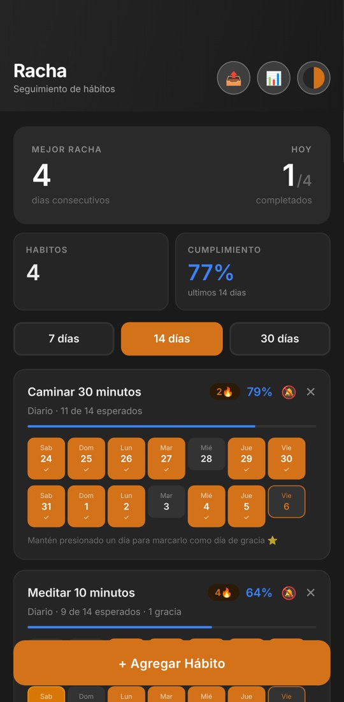
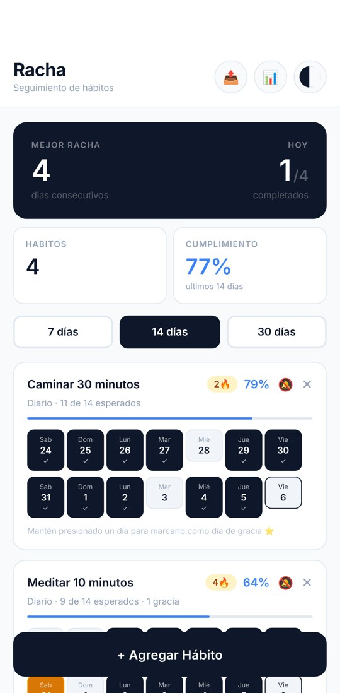
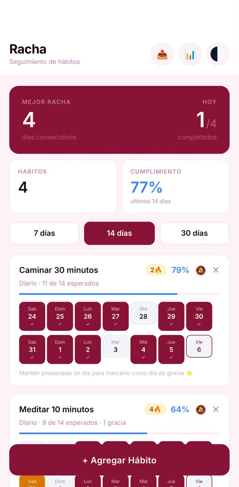
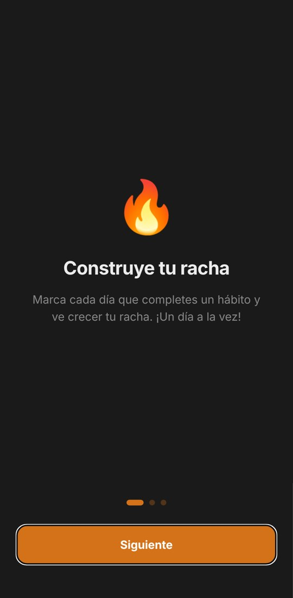
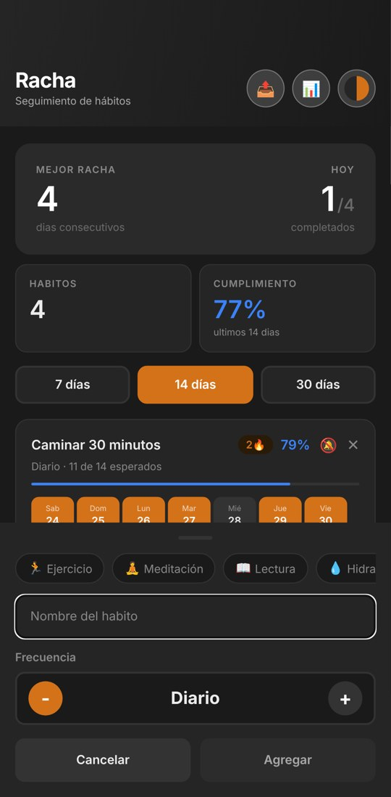

<div align="center">

# Racha

### A minimalist habit tracker for Android, built on streaks

React Native · Expo · TypeScript · no accounts, no subscriptions, no ads

</div>

<table>
<tr>
<td></td>
<td></td>
<td></td>
</tr>
<tr>
<td align="center"><sub>Dark</sub></td>
<td align="center"><sub>Light</sub></td>
<td align="center"><sub>Rose</sub></td>
</tr>
</table>

---

## The idea

Most habit apps punish you for a single missed day. Racha (Spanish for *streak*) keeps the motivation of a streak but measures what matters more: **how consistent you've been over the last 7, 14 or 30 days**. Each habit shows a grid of its recent days, a completion rate and its current streak, and you tick a day with one tap.

## Features

**Tracking**
- Habits with their own frequency, from once to seven times a week.
- A rolling window of 7, 14 or 30 days, with the completion rate per habit and overall.
- Streak counter per habit. The streak isn't lost just because today isn't ticked yet.
- **Grace days**: long-press a missed day to excuse it. One per seven-day window; it keeps the streak without counting as done.

**Engagement**
- A three-slide introduction on first launch.
- Suggestions by category (exercise, meditation, reading, hydration, sleep, diet, languages) to start a habit in one tap.
- A spring animation on every tick and a progress bar that changes colour with the rate.
- Weekly and monthly statistics with best streaks, totals and a monthly calendar per habit.
- **Share progress**: one tap writes a weekly summary and opens the phone's share sheet.
- A daily reminder per habit, at the time you choose.

**Customisation**
- Three themes — dark, light and rose — remembered between sessions.

<table>
<tr>
<td></td>
<td></td>
</tr>
<tr>
<td align="center"><sub>First launch</sub></td>
<td align="center"><sub>Adding a habit, with suggestions by category</sub></td>
</tr>
</table>

## How it was built

| Layer | Technology |
|---|---|
| Framework | React Native + Expo SDK 55 |
| Navigation | Expo Router (file-based) |
| Language | TypeScript (strict) |
| Storage | AsyncStorage, on the device |
| Animations | React Native Animated API |
| Notifications | expo-notifications |

All habit state and its derived statistics live in one hook (`useHabits`), and the date logic in small pure helpers, so the screens only render. Built with AI agents (Claude Code) as the main development tool.

## Project structure

```
src/
├── app/
│   └── index.tsx             main screen
├── components/
│   ├── HabitCard.tsx         habit card with the day grid and spring animations
│   ├── StatsPanel.tsx        summary panel at the top
│   ├── StatsModal.tsx        weekly and monthly statistics
│   ├── AddHabitForm.tsx      new habit form with category suggestions
│   ├── OnboardingModal.tsx   first-launch introduction
│   ├── NotificationModal.tsx reminder time per habit
│   ├── ThemeModal.tsx        theme picker
│   ├── DeleteModal.tsx       delete confirmation
│   ├── WindowPicker.tsx      7 / 14 / 30 day selector
│   └── EmptyState.tsx        empty list
├── hooks/
│   ├── useHabits.ts          habit state, changes and statistics
│   └── useAppTheme.ts        theme and window size, saved
├── constants/themes.ts       the three palettes
├── types/habit.ts            TypeScript types
└── utils/dates.ts            date helpers
```

## Run it

Requires Node.js 18+ and an Android device or emulator.

```bash
git clone https://github.com/rikochet87/racha.git
cd racha
npm install
npx expo start --clear
```

Build an Android APK with EAS:

```bash
eas build --platform android --profile preview
```

Reminders need a native build; they don't fire in Expo Go.

## Roadmap

- Home screen widget
- Cloud backup
- Habit categories with icons

## License

MIT © 2026 Matías Rosello

---

<div align="center">

**Matías Rosello** · [GitHub](https://github.com/rikochet87) · rosellomatias87@gmail.com

</div>
